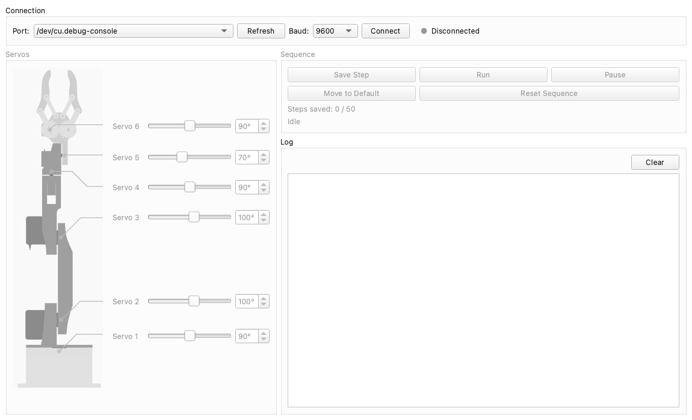

# Ruka

[](https://github.com/AndrewwSSS/ruka/actions/workflows/check.yml)
[](LICENSE)


A 6-servo robotic arm on an Arduino Uno, with a cross-platform desktop app that
controls it over USB or Bluetooth and records and replays movement sequences.



## Features

- **Desktop app** for Windows, macOS and Linux (PySide6): a slider per servo next
  to a diagram of the arm, sequence controls, and a live log.
- **Record and replay:** save up to 50 poses, then play them back in order; each
  step starts once every servo has reached the previous one.
- **USB or Bluetooth:** the same commands work over USB serial and a paired
  HC-05 module.
- **Smooth, non-blocking motion** from the
  [MotorControl](https://github.com/AndrewwSSS/MotorControl) library: servos on
  a PCA9685 board move one degree at a time while the firmware keeps reading
  commands.
- **Ready-made builds:** every change to the app publishes Windows, macOS and
  Linux executables as the
  [latest release](https://github.com/AndrewwSSS/ruka/releases/tag/latest).
- **A tested protocol:** unit tests check the app's commands, and that its
  constants match the firmware source.

## Repository layout

| Path | Contents |
| --- | --- |
| [`firmware/`](firmware) | Arduino Uno sketch (PlatformIO), Fritzing wiring diagram |
| [`desktop/`](desktop) | the desktop app (Python, PySide6), tests, packaging |
| [`docs/`](docs) | serial protocol and wiring |
| [`Makefile`](Makefile) | common tasks for both halves |

## Getting started

Run `make` in the repository root to list the common tasks.

**Firmware** (requires [PlatformIO](https://platformio.org/); libraries are
fetched automatically):

```sh
make upload      # build and upload to the connected Uno
make monitor     # serial monitor
```

**Desktop app:** download an executable from the
[latest release](https://github.com/AndrewwSSS/ruka/releases/tag/latest), or
run it from source with Python 3:

```sh
make app
```

Then pick the board's serial port at 9600 baud and press **Connect**. More in
[desktop/README.md](desktop/README.md).

## Documentation

| Guide | Covers |
| --- | --- |
| [Serial protocol](docs/protocol.md) | commands, status lines, shared constants |
| [Wiring](docs/wiring.md) | the Uno, the PCA9685 board, the servos and the HC-05 module |
| [Desktop app](desktop/README.md) | running, connecting, packaging |

## Tests

```sh
make test     # protocol tests, standard library only
make check    # the tests plus the firmware build
```

CI runs both on every push and pull request.

## License

[MIT](LICENSE)
