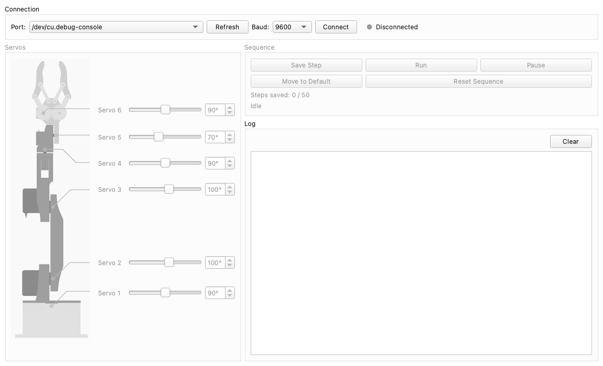

# Ruka Control

A cross-platform desktop app (Windows, macOS, Linux) for the Ruka arm: move
each servo, record poses and replay them, over USB serial or a paired HC-05
Bluetooth module. Built with PySide6 and pyserial.



## Download

Ready-made executables for Windows, macOS and Linux are published as the
[latest release](https://github.com/AndrewwSSS/ruka/releases/tag/latest) on
every change to the app.

## Run from source

Requires Python 3 and `make`.

```sh
make run
```

On first use this creates `.venv` and installs [`requirements.txt`](requirements.txt).
`make help` lists the other targets.

Without `make`:

```sh
python3 -m venv .venv
.venv/bin/pip install -r requirements.txt    # Windows: .venv\Scripts\pip
.venv/bin/python run.py                       # Windows: .venv\Scripts\python run.py
```

## Connecting

- **USB:** plug in the Arduino, choose its serial port (`COMx` on Windows,
  `/dev/cu.usbmodem*` or `/dev/cu.usbserial*` on macOS, `/dev/ttyACM*` or
  `/dev/ttyUSB*` on Linux), keep the baud rate at **9600**, and press
  **Connect**.
- **Bluetooth:** pair the HC-05 module in the system's Bluetooth settings first
  (the PIN is usually `1234` or `0000`). This creates a serial port that you
  choose the same way.

Over Bluetooth the arm receives commands but sends no status back, so the step
counter and playback state are only updated over USB. Details:
[serial protocol](../docs/protocol.md).

## Tests

```sh
make test
```

Runs the protocol tests with the standard library only; no virtualenv needed.

## Packaging

```sh
make build      # or: ./build.sh
```

Builds a single portable executable with PyInstaller: `dist/Ruka.exe` on
Windows, `dist/Ruka` on macOS and Linux. PyInstaller does not cross-compile, so
build on each system; `build.sh` works unchanged on all three.

## Layout

| Path | Contents |
| --- | --- |
| [`ruka_app/core/protocol.py`](ruka_app/core/protocol.py) | the command protocol |
| [`ruka_app/core/serial_link.py`](ruka_app/core/serial_link.py) | the serial connection, on a background thread |
| [`ruka_app/ui/`](ruka_app/ui) | the window and its panels |
| [`resources/`](resources) | icons and the arm diagram |
| [`tests/`](tests) | unit tests |
